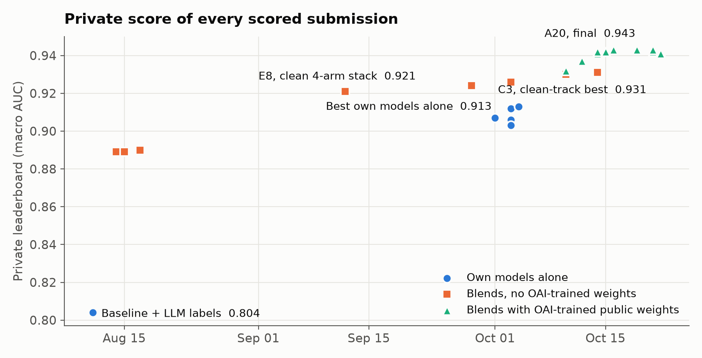
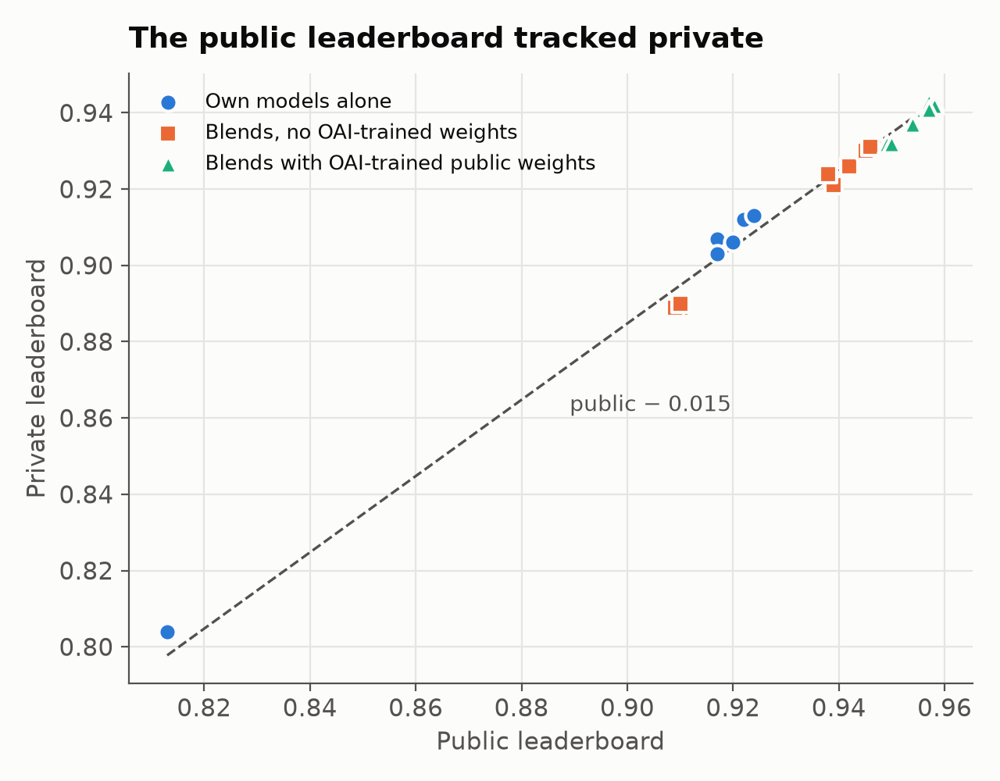

# RSNA Knee Abnormality Detection

My solo solution to Kaggle's [RSNA Knee Abnormality Detection](https://www.kaggle.com/competitions/rsna-knee-abnormality-detection)
competition: predict twelve findings (ACL, MCL, menisci, osteoarthritis, effusion, synovitis, Baker's cyst, contusion,
fracture) from knee MRI, scored as macro ROC AUC.

| | |
|---|---|
| **Private leaderboard** | **0.943, rank 320 / 6,299 (top 5.1 %), 🥉 bronze** |
| Public leaderboard | 0.958, rank 422 |
| Winning private score | 0.960 |
| Final submission | [`rsna-knee-oai-a20`](https://www.kaggle.com/code/tranbadat/rsna-knee-oai-a20), a blend of audited public models and my S6T model |
| Dates | 2026-08-05 → 2026-10-22, code competition (offline, 9 h limit) |

Standings read 2026-11-02. Silver ended near rank 315; 287 teams share 0.943 at three decimals.

**The problem.** Only 58 of 4,407 training studies have expert labels. Every study has a free-text radiology report, in
several languages, but the test set has none. So the task is to build training labels from reports, then train an imaging
model that works without them.



## My work and other people's work

The final score relies mostly on public notebooks and weights. My own models alone reached 0.913 private.

**Mine**
- An [LLM report labeler](scripts/llm_label_gold.py) that labeled all 4,407 reports. It is resumable and token-budgeted, and
  it reached 0.869 agreement on the gold studies, against 0.814 for the rule-based extractor.
- A [CoAtNet 2.5-D attention-MIL pipeline](src/rsna_knee/mil/) rebuilt from the public 0.94 stack, with one shared decode
  across arms and fixed weights, in about 2.5 h of the 9 h limit (E8, 0.921 private). The repo has 102 unit tests.
- Own models: ConvNeXt-nano k-fold models, a CoAtNet fine-tuned on report labels (ftC5o, in the clean-track best), and
  **S6T**, heliosli's S6 recipe retrained on my labels ([weights](https://www.kaggle.com/datasets/tranbadat/rsna-knee-s6t-weights)).
- The method: every external notebook audited before use, keep/discard rules written before each result was read, and every
  experiment logged in [`docs/experiment_ledger.md`](docs/experiment_ledger.md).

**From public work**
- The core of the final blend: the 0.9586 recipe and R6/S6 legs by heliosli, the OAI-trained CoAtNet and s6fall weights by
  nartaa, the 2.5-D ConvNeXt reader by goodpjw2008. See [Credit](#credit).

## What moved the score

| Step | Public | Private |
|---|---:|---:|
| Baseline notebook + my LLM labels | 0.813 | 0.804 |
| My own models alone (R5t + 2 full-data models) | 0.924 | 0.913 |
| Clean 4-arm CoAtNet stack (E8) | 0.939 | 0.921 |
| Best blend with no OAI-trained weights (C3) | 0.946 | 0.931 |
| Public 0.9586 notebook, audited and unchanged (A16) | 0.958 | 0.942 |
| **A16 + s6fall + my S6T (A20, final)** | **0.958** | **0.943** |

The only lever that worked late on was a strong, decorrelated extra leg. Weight tweaks, TTA, flip views and more checkpoints
of the same family gave nothing measurable. Six candidate legs failed gates set in advance.

All scores by phase are in [`docs/results.md`](docs/results.md).

## What I learned

- **Labels were the real bottleneck, and I missed it.** I read reports only. The top teams had vision models read the MRI
  with the report and reached about 0.94–0.95 label agreement on gold-58, against my 0.90.
- **A 58-study gold set can't rank close candidates.** Among my 12 strongest blends, its rank correlation with private was
  0.03, against 0.70 for the public leaderboard. It stayed useful as a regression guard.
- **Public tracked private here.** The drop averaged 0.015 across 30 submissions, with almost no reordering.
- **Plan runtime early.** Three of my last ten submissions exceeded 9 h on the hidden test and returned no score.



The full analysis, including what the winners did differently, is in the
[post-mortem](reports/postmortem.md).

## Repo guide

```
reports/postmortem.md          start here: result, what predicted private, what the winners did
docs/results.md                every scored submission by phase
docs/report.md                 2026-09 study: why the 0.94 stack works
docs/experiment_ledger.md      every hypothesis, rule, result and decision, in order
docs/phase{2,3,4}_notes.md     own models; OAI and clean tracks; the final-week leg search
reports/final-selection.md     evidence behind the final picks
scripts/llm_label_gold.py      LLM report labeler
src/rsna_knee/                 imaging package; mil/ holds the CoAtNet pipeline and k-fold models (module map in its README)
tests/                         unit tests, no DICOMs or weights needed
experiments/                   Kaggle kernels and analysis scripts, by phase
eda/                           EDA and baseline notebook
CLAUDE.md                      working notes for Claude Code, which ran much of the experiment loop
```

## Setup

```bash
conda env create -f environment.yml   # CPU-only; all GPU work ran on Kaggle
conda activate rsna-knee
pytest

# or, without conda
pip install -e ".[dev,viz,mil]" python-dotenv openai kaggle
```

Competition data is not in this repo. Accept the competition rules, download `train.csv` to `data/`, then run
`python scripts/extract_gold.py` to build the gold table that other scripts read. To run the labeler:

```bash
cp .env.example .env                         # add your OpenAI key
python scripts/llm_label_gold.py --limit 6   # smoke test
python scripts/llm_label_gold.py             # full run; re-run the same command to resume
```

`data/` does hold my LLM-generated label tables, keyed by study ID. They contain no report text.

## Credit

- **Baseline:** the EDA and first imaging pipeline build on
  [Roman Rozen's public notebook](https://www.kaggle.com/code/romanrozen/rsna-knee-data-structure-eda-baseline).
- **Final blends:** heliosli (R6/R7/S6 legs and the 0.9586 recipe), nartaa (OAI-trained CoAtNet and s6fall), goodpjw2008
  (2.5-D ConvNeXt reader), varshithakolupuri.
- **CoAtNet pipeline:** dreaddevelopment (Raptor checkpoints and pre-decoded corpus), mattiaangeli (residual-gated CoAtNet),
  and report-label tables by flight0234, stevenleehans, yunusgmsoy and pilkwang.
- **Phase 2 blends:** the public `jiweiliu/rsna-knee-fast-2xt4-inference` notebook.

## License

My code is under the [MIT License](LICENSE). Competition data is subject to Kaggle's rules and the RSNA MIRA license.
Public checkpoints, notebooks and label tables keep their authors' licenses (RadImageNet-derived artifacts are
CC-BY-NC-SA-4.0).
